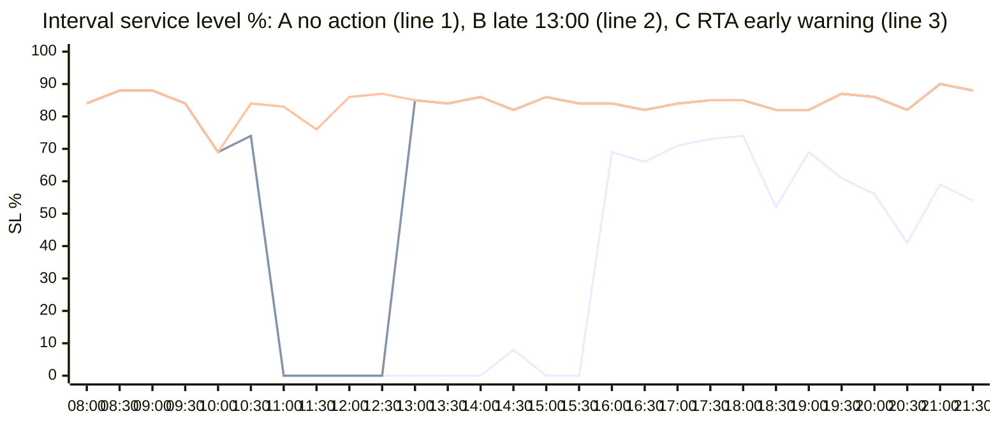

# Intraday RTA Early-Warning Simulator

**How much service level does catching a problem early actually save?**
This project simulates one contact-centre day with a volume spike and unplanned absenteeism, then compares three ways a real-time / intraday team could respond.

> **Data note:** all data is **simulated**. No company or customer data is used.



## The scenario

- 08:00–22:00, 30-minute intervals, AHT 300 s, target **80/20**
- **+25% unplanned volume** from 11:00 to 16:00 (think outage or campaign)
- **2 agents absent** from 10:00

| Response | What happens |
|---|---|
| A. No real-time action | The plan never changes |
| B. Late reaction | Someone notices at 13:00 and adds capacity |
| C. RTA early warning | Rule-based alerts: volume **>10% over forecast for 2 consecutive intervals**, or **staffed < Erlang C requirement**. Capacity is added one interval later (cancel offline activities, move multi-skilled agents, voluntary OT), capped at +6 agents |

## Key findings (simulated day)

| Scenario | Daily SL | Intervals below 80/20 | Extra agent-hours |
|---|---:|---:|---:|
| A. No real-time action | **37.3%** | 24 of 28 | 0 |
| B. Late reaction (13:00) | **62.4%** | 6 | 21.5 |
| C. RTA early warning (alert 10:00) | **83.7%** | 2 | 33.5 |

- The alert fired at **10:00**, as soon as staffing dropped below requirement and an hour before the volume spike.
- Reacting **3 hours earlier** turned a missed day (62%) into a met day (84%).
- When staffing falls below the traffic load, Erlang C shows the queue becomes unstable and **service level collapses to near 0**, not "a bit lower". That is why the first hour of a disruption matters most.
- Early action used ~12 more agent-hours than the late reaction. The real decision is whether that cost is worth +21 points of SL, which is the conversation an RTA has with operations.

## Run it

```bash
pip install -r requirements.txt
python rta_early_warning.py
```

## Skills shown

Real-time monitoring · Intraday management · Erlang C · Alert rule design · Scenario analysis · Python

---
Built by **Rahul**, Control Tower – WFM Analyst. [LinkedIn](https://www.linkedin.com/in/rahul-219543159/)
